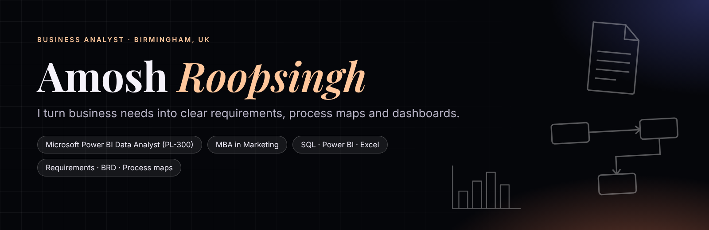
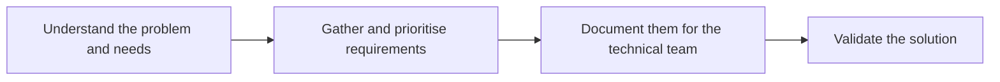
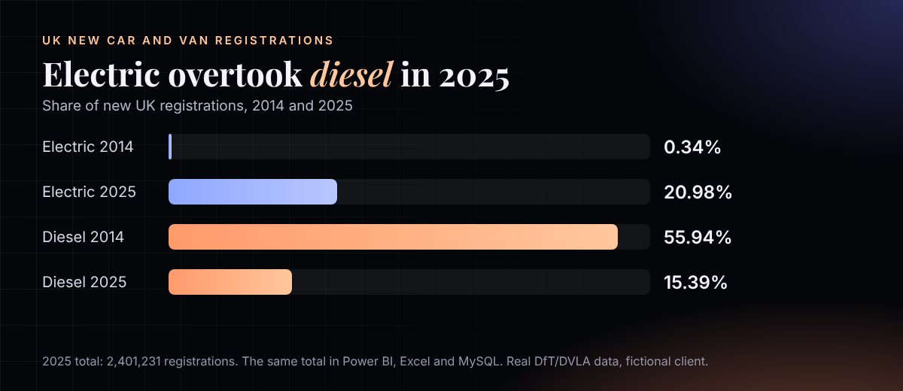
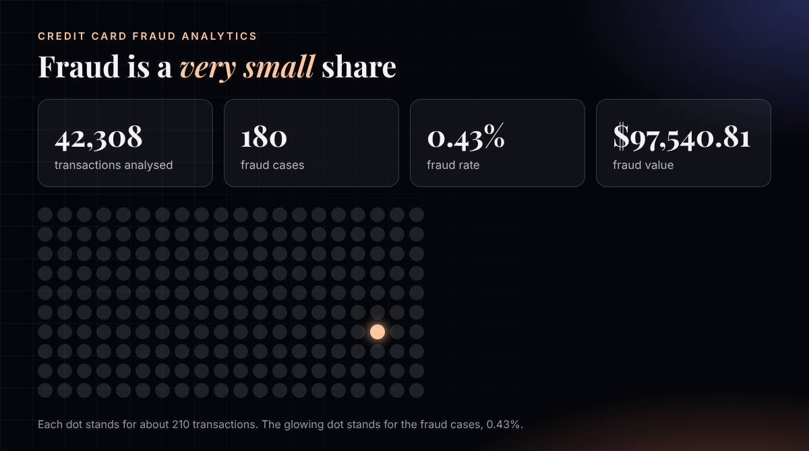
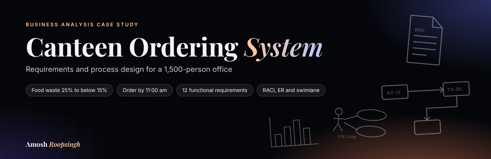
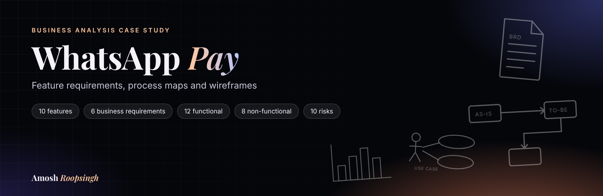

  

  
  
  

## About me
I turn business needs into clear requirements, process maps and dashboards.

At SSP Group I analyse service performance and KPIs, look for the root causes of operational issues and support process improvements. Before that I spent 9+ years in sales in India, which taught me customers, commercial thinking and communication. I moved into Business Analysis, trained for it, and built the projects below.

## How I work

## Education and certification

| | |
|---|---|
| 🏅 **Power BI Data Analyst Associate (PL-300)** | Microsoft, Oct 2026 |
| 🎓 **MBA in Marketing** | Alagappa University, India |
| 🎓 **B.Com in Retail Marketing** | PSG College of Arts & Science, India |
| 📚 **Programme** | AI-Powered Business Analyst Programme, Fortray / Simplilearn |

## Skills

| Area | What I do |
|---|---|
| 📝 **Requirements and documentation** | Requirements elicitation, functional requirements, BRD, user stories and acceptance criteria, use cases |
| 🔄 **Process analysis** | AS-IS / TO-BE process mapping, gap analysis, root cause analysis, business performance analysis, process improvement |
| 📊 **Data and reporting** | SQL, Power BI (Power Query, DAX), Advanced Excel, KPI dashboards, data cleaning |
| ✅ **Testing and delivery** | UAT support, Agile / Scrum frameworks |
| 🧰 **Diagram tools** | Lucidchart, draw.io |

**Training only (not used in my projects yet):** CBAP · Jira · Confluence · Microsoft Visio · Tableau Desktop · Python (Pandas, Matplotlib, Seaborn) · Business Analytics with Excel · GenAI Powered SQL for Business Analysts · RPA and Process Mining basics · Agile Frameworks · Microsoft Azure Data Fundamentals

---

## Projects

| # | Project | Type | Tools | Repo |
|:---:|---|---|---|---|
| 1 | **UK New Car and Van Registrations** | Portfolio project (fictional client, real DfT/DVLA data) | SQL, Power BI, Excel, BRD | [uk-vehicle-registrations](https://github.com/amoshr/uk-vehicle-registrations) |
| 2 | **Credit Card Fraud Analytics** | Programme capstone | SQL, Advanced Excel, Power BI, BRD | [credit-card-fraud-analysis](https://github.com/amoshr/credit-card-fraud-analysis) |
| 3 | **Canteen Ordering System** | Requirements case study | BRD, RACI, swimlane, ER diagram, prototype | [canteen-ordering-system](https://github.com/amoshr/canteen-ordering-system) |
| 4 | **WhatsApp Pay** | Requirements case study | BRD, use case diagram, process flows, wireframes | [whatsapp-pay-requirements](https://github.com/amoshr/whatsapp-pay-requirements) |

### 1. UK New Car and Van Registrations
**Question:** Which vehicles and fuel types is the UK market moving towards, and which makes are winning?

| Finding | Result |
|---|---|
| ⚡ Battery electric share | 0.34% (2014) → 20.98% (2025) |
| ⛽ Diesel share | 55.94% (2014) → 15.39% (2025) |
| 🔁 Fuel switch | In 2025 electric passed diesel as a full-year share |
| 🚗 2025 total registrations | 2,401,231 (+1.6%) |
| ✅ Cross-check | Same 2025 total in Power BI, Excel and MySQL |

**What I did**
- Wrote a Business Requirements Document for a fictional fleet client.
- Cleaned and reshaped public data in Power Query.
- Built DAX measures and a 4-page Power BI dashboard.
- Checked the numbers with SQL. The check caught a slicer that was filtering to cars only.

### 2. Credit Card Fraud Analytics
**Objective:** find unusual credit card spending patterns and possible fraud risks through transaction analysis.

**What I did**
- Wrote a Business Requirements Document: scope, stakeholder needs, analytical objectives.
- Designed the ERD and use case diagram.
- Fixed date-format and card-number data-type problems on import.
- Analysed transactions with SQL and Excel (COUNTIF, SUMIF, AVERAGEIFS).
- Built a 3-page Power BI dashboard to track suspicious transaction patterns.

### 3 and 4. Requirements case studies
Two course case studies. They are not real client projects. Each repo has the full Word document, the diagrams and wireframes.

<table>
  <tr>
    <td width="50%"> <b>Canteen Ordering System</b> Pre-order lunch before 11:00 am. Food waste target: 25% to below 15%. <a href="https://amosh-canteen-prototype.lovable.app">Open the prototype</a> (sample data, built with an AI app builder).</td>
    <td width="50%"> <b>WhatsApp Pay</b> Send money inside a chat. 10 features, 26 requirements, 10 risks, 2 future-state flows and wireframes.</td>
  </tr>
</table>

---

Birmingham, UK · Case studies are course projects or use fictional clients. Prototype data is sample data.

